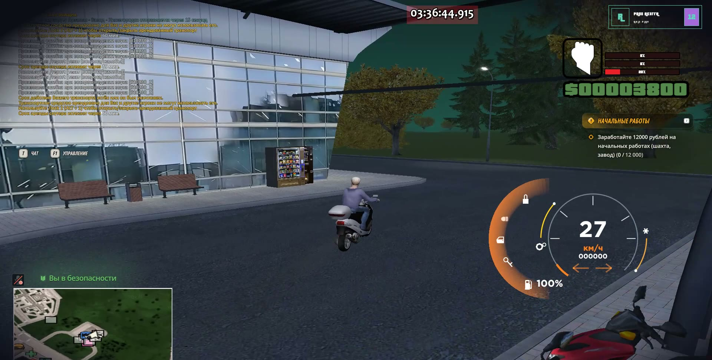
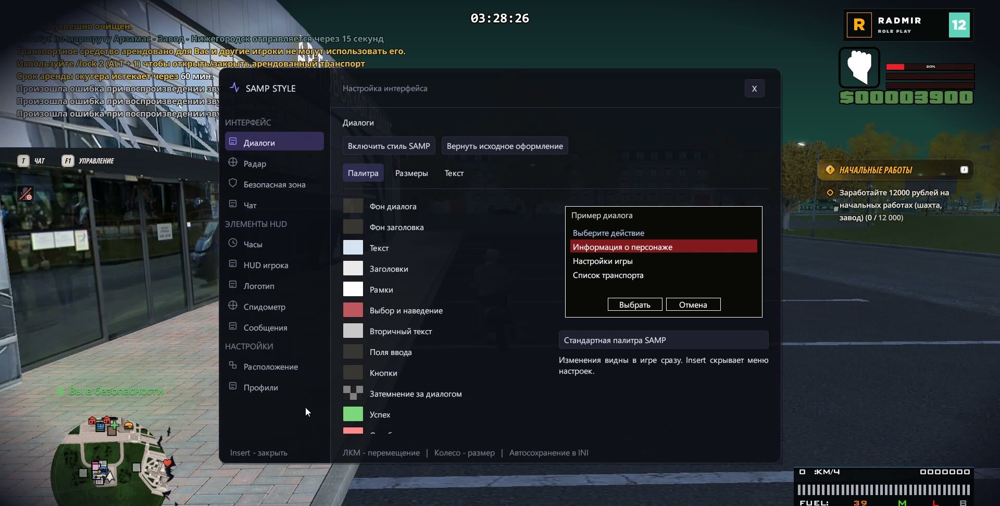
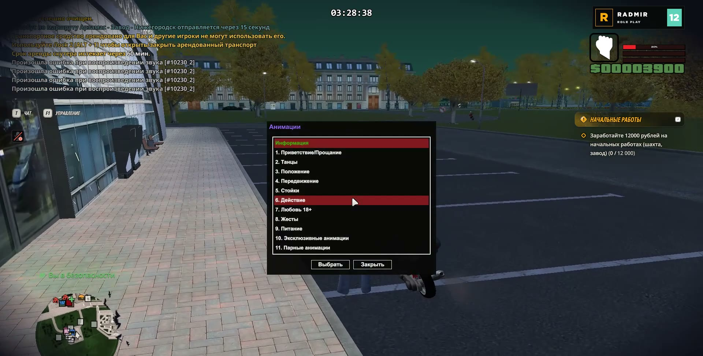
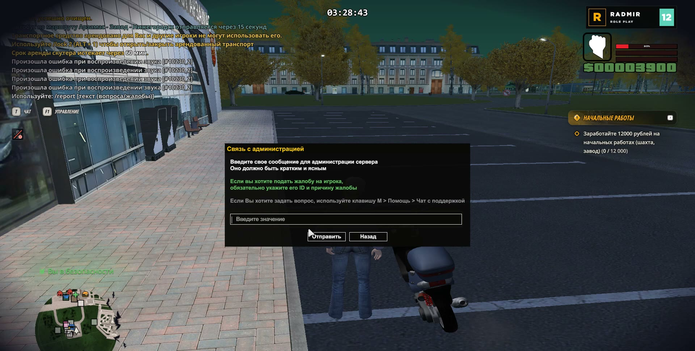
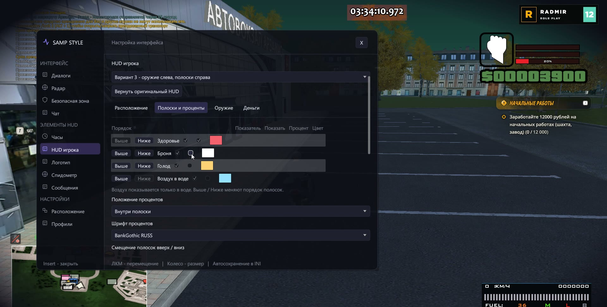
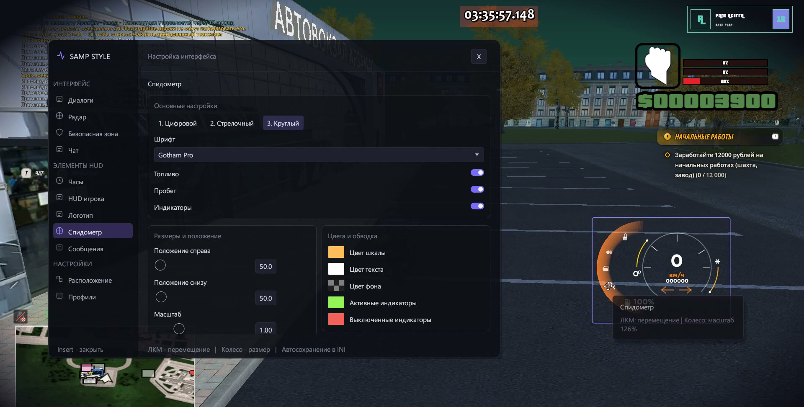
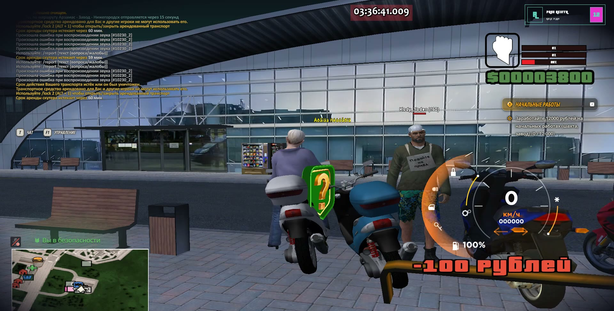
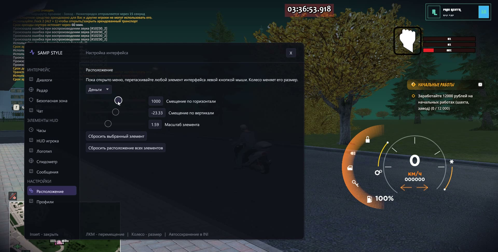

# radmir-oldStyle-sborki

Сборка для RADMIR CRMP, которая возвращает олдовый SAMP-стиль: диалоги как в сампе, нормальный радар, старые сообщения по центру экрана, спидометр, часы и т.д. Всё настраивается прямо в игре через меню на **Insert**, ничего руками в файлах ковырять не надо.

Написано на Rust. Модуль цепляется к игре, рисует своё меню поверх и подменяет стили у игрового интерфейса.



## Что умеет

- **Диалоги** — серверные диалоги в стиле SAMP (чёрный фон, красное выделение, кнопки с рамкой). Палитру, размеры и шрифт можно поменять, есть кнопка вернуть как было. Для тех кто шарит можно докинуть свой CSS
- **Радар** — квадрат, круг, овал или прямоугольник, размер колесиком мыши, рамка и цвет
- **Безопасная зона** — надпись "Вы в безопасности" над радаром, свой текст, шрифт, обводка
- **Чат** — шрифт, размер, количество строк, ширина, обводка
- **Часы** — сверху по центру или где удобно, секунды/миллисекунды, 24ч формат
- **HUD игрока** — деньги с нулями как в сампе ($00003900), оружие, полоски хп/брони/голода/воздуха, проценты. Можно поставить свои иконки и свою картинку оружия (PNG/JPG/GIF)
- **Логотип** — несколько вариантов, свой текст, цвет под номер сервера, своя картинка или гифка
- **Спидометр** — три вида: цифровой, стрелочный и круглый
- **Сообщения** — старые сообщения по центру экрана, типа "ДВИГАТЕЛЬ ЗАПУСКАЕТСЯ..." и "-100 рублей" шрифтом Pricedown
- **Расположение** — пока открыто меню, любой элемент можно перетащить мышкой и поменять размер колесиком
- **Профили** — всё сохраняется само в `settings.ini`, можно сохранить отдельный профиль и потом загрузить

## Скрины

Меню настроек (Insert):



Диалоги:




HUD:



Спидометр:



Старые сообщения:



Расположение элементов:



## Установка

Готовые файлы лежат в папке [`bin`](bin). Есть два способа, выбирайте **один**, вместе не надо.

### Способ 1 — через ASI (проще)

1. Кидаете `OldDialogs.asi` в корень игры (по умолчанию `C:\Program Files (x86)\RADMIR Games\RADMIR CRMP`)
2. Заходите в игру
3. Жмёте **Insert** — откроется меню

Нужен ASI Loader, но он в радмире и так есть.

### Способ 2 — через лаунчер (инжект)

1. Кладёте `OldDialogs.dll` и `OldDialogsLauncher.exe` в одну папку (куда угодно)
2. Запускаете игру
3. Запускаете `OldDialogsLauncher.exe`
4. В игре **Insert**

Если лаунчер пишет "Запустите RADMIR CRMP из указанной папки игры" — значит игра не запущена или стоит не в `C:\Program Files (x86)\RADMIR Games\RADMIR CRMP`. Путь пока зашит жёстко, потом может сделаю выбор.

Ещё у лаунчера есть ключи, может кому пригодится:

```
OldDialogsLauncher.exe --show       открыть меню
OldDialogsLauncher.exe --hide       закрыть меню
OldDialogsLauncher.exe --reload     перечитать settings.ini
OldDialogsLauncher.exe --status     состояние модуля
OldDialogsLauncher.exe --stop       выгрузить
OldDialogsLauncher.exe --pid 1234   если открыто несколько окон игры
OldDialogsLauncher.exe --quiet      без окошек
```

## Готовый конфиг

В `profiles/settings.ini` лежит мой конфиг, как на скринах. Если хотите так же — киньте его рядом с `OldDialogs.asi` / `OldDialogs.dll` и в меню нажмите "Перечитать настройки с диска" (раздел Профили).

## Если что-то не работает

- Рядом с модулем появляется `last-error.txt` — там написано что сломалось
- Если меню не открывается — разверните игру и подождите пару секунд, модуль ждёт пока прогрузится интерфейс
- "В игре загружено несколько копий OldDialogs" — вы поставили и asi, и инжектили dll. Оставьте что-то одно и перезапустите игру
- После обновления сборки игру лучше перезапустить

## Сборка из исходников

Нужны Rust (1.85+) с таргетом `i686-pc-windows-msvc` и Visual Studio Build Tools с x86 компилятором. Игра 32-битная, поэтому и собирается под x86.

```
rustup target add i686-pc-windows-msvc
.\build.ps1
```

Скрипт сам найдёт MSVC и Windows SDK и положит `OldDialogs.dll`, `OldDialogs.asi` и `OldDialogsLauncher.exe` в `bin`.

## Структура

```
src/            сам модуль (dll)
src/launcher/   лаунчер-инжектор
assets/         css/js которые подкидываются в игровой интерфейс + шрифты
profiles/       пример конфига
bin/            готовые файлы
```

---

Делал для себя, но если нашли баг или есть идея — пишите в issues.
Использование на свой страх и риск, за баны от администрации ответственности не несу.
